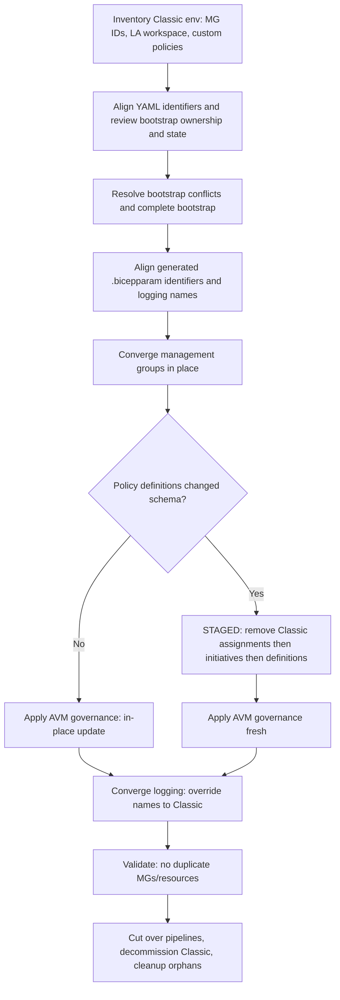

A practical, step-by-step guide for moving an existing **ALZ-Bicep (Classic)** platform to the **Azure Verified Modules (AVM) Bicep accelerator** ([`alz-bicep-accelerator`]()), retaining your live management groups and logging resources while re-baselining governance where needed. Networking (hub/vWAN) is planned for a future revision.

## Overview

ALZ-Bicep (Classic, `Azure/ALZ-Bicep`) is being retired — the Classic starter was removed from the Accelerator on **2026-02-16**, and the repository will be **archived on 2027-02-16** (bug/security/policy fixes only in between). The successor is the **Bicep AVM accelerator**, configured through `platform-landing-zone.yaml` (top-level inputs that are rendered into per-module `.bicepparam` files) plus the shared **ALZ Library**, and deployed through its pipelines.

This guide describes Bicep platform convergence, its policy-update blocker, and the separate bootstrap checks required before using the Accelerator with an existing environment.

### What you get from this migration

- Same management-group hierarchy, retained **in place** when parent IDs and subscription-placement settings are aligned and reviewed before both bootstrap and platform deployment.
- Governance (policy/RBAC) re-based onto the maintained AVM library.
- A modern, config-driven deployment model going forward.

## Who this is for & scope

- **Audience:** platform/landing-zone operators running ALZ-Bicep Classic today.
- **In scope:** management groups, policy (definitions/initiatives/assignments/role assignments), logging. RBAC and subscription placement follow the same pattern.
- **Out of scope (call out separately):** hub/vWAN networking — the same *principles* apply (align names/RGs), but they are not covered in detail here. Networking migration guidance is planned for a future revision.

## The mental model (read this first)

Two facts make this migration tractable:

1. **Both platform frameworks are Bicep/ARM — declarative and idempotent, with no Terraform state file for the platform resources.** You **converge** the new configuration onto the existing resources and let ARM reconcile. However, **Accelerator bootstrap uses Terraform even when you select Bicep**. Its management group, managed identities, resource groups, and CI/CD resources have a separate Terraform state and are not automatically adopted when their names match.
2. **ARM updates in place only when the resource *name/ID* matches.** If a name differs, ARM **creates a new resource** instead of updating the existing one. So the entire migration comes down to **making the AVM configuration produce the same identifiers your Classic deployment already created.**


**Strategy: in-place brownfield convergence.** Re-point deployment to the AVM accelerator, configured so its identifiers match the existing environment, and let ARM converge. A *parallel build + cutover* is the fallback only when identifiers genuinely cannot be aligned.


## How the two frameworks differ

| Layer | Classic (`ALZ-Bicep`) | AVM accelerator (`alz-bicep-accelerator`) |
|---|---|---|
| MGs & governance | `managementGroups`, `policy`, `roleAssignments`, `customRoleDefinitions` | `templates/core/governance` + ALZ Library |
| Logging | `logging`, `mgDiagSettings` | `templates/core/logging` |
| Networking | `hubNetworking` / `vwanConnectivity` (+ spokes, peerings, DNS) | `templates/networking/hubnetworking` / `virtualwan` |
| Config model | **Hand-authored** per-module `.bicepparam` + **manual** orchestration | `platform-landing-zone.yaml` (top-level inputs) **rendered into per-module `.bicepparam` files** + ALZ Library |
| Deploy driver | Per-module CLI/pipeline | **Still pipeline-driven (CI/CD)** — `Deploy-Accelerator` scaffolds the CI/CD pipeline + rendered config; the pipeline runs the ordered `deployment_files` |

### How the AVM accelerator is configured and deployed

The accelerator is **not** a single YAML file, and it is **still pipeline-driven**. Understanding its two-layer model is key to a clean migration.

**Configuration is two layers:**

1. **Top-level inputs** — `config/inputs.yaml` and `config/platform-landing-zone.yaml` in your target repo. These hold the high-level settings you author (MG IDs, subscription placement, feature toggles, and so on).
2. **Rendered per-module `.bicepparam`** — the `Deploy-Accelerator` bootstrap renders those inputs into concrete `main.bicepparam` files under the generated `templates/` tree (for example `templates/core/logging/main.bicepparam` and `templates/core/governance/mgmt-groups/*/main.bicepparam`). Some settings are exposed **only** in these rendered files — notably the logging resource names — and are edited there after bootstrap.

The shared **ALZ Library** supplies the archetypes and policy definitions/assignments that the governance modules consume.

**Deployment is pipeline-driven (CI/CD).** `Deploy-Accelerator` scaffolds a CI/CD pipeline (GitHub Actions or Azure DevOps) alongside the configuration above. You commit configuration changes and **the pipeline** runs the ordered `deployment_files` (from `.config/ALZ-Powershell.config.json`) — each an `az deployment mg` / `az deployment sub` at the appropriate scope (see Appendix B). The operating model is therefore the same as Classic — edit config, pipeline deploys — just consolidated and config-driven rather than per-module scripts.

**What this means for migration:** align identifiers across **both** layers — MG IDs in `platform-landing-zone.yaml`, logging/resource names in the rendered `.bicepparam` files — then let the pipeline converge onto the existing environment.

### The two naming differences that matter most

1. **Management-group IDs.** Classic uses **nested** IDs (`<prefix>-platform-connectivity`, `<prefix>-landingzones-corp`). AVM defaults to **flat** IDs (`connectivity`, `corp`) and nests only via the *parent* relationship. → You must override each AVM MG ID to the full Classic ID.
2. **Logging resource names.** Classic: `alz-log-analytics`, `alz-logging-mi`, `alz-ama-*-dcr`. AVM default: `law-alz-<loc>`, `mi-alz-<loc>`, `dcr-*-alz-<loc>` (and the RG gets a `-<loc>` suffix). → You must override these names to adopt the existing workspace.

## Prerequisites

- **Tenant-root deployment rights.** The MG layer deploys at tenant scope; you need `Microsoft.Resources/deployments/*` at `/` (or create/align the MGs under an owned parent MG if you don't have root rights).
- Azure CLI + Bicep, and the **ALZ PowerShell bootstrap** (`Deploy-Accelerator`).
- A full **inventory of your Classic environment**: MG IDs, Log Analytics workspace name + RG, custom policy/initiative names, and the identities/DCRs the policies reference.
- A non-production run first (a sandbox or the same environment with `what-if`).


**No tenant-root rights?** The Classic `managementGroups` module and the AVM MG layer both deploy at **tenant scope** (deployment rights required at `/`). If you don't have them, pre-create the management groups under a parent MG you own, then deploy only the MG- and subscription-scoped layers (policy, logging).


Pre-create example (repeat for each MG, using the nested IDs from Step 2):

```bash
az account management-group create --name "<prefix>-platform" --display-name "Platform" --parent "<owned-parent-mg-id>"
```

## Migration at a glance



## Step-by-step


Inventory your environment and align the YAML identifiers in Steps 1 and 2 **before applying bootstrap**. Complete the bootstrap checkpoint below before proceeding to Step 3. Edit the rendered `.bicepparam` files after bootstrap has generated the target repository, but before running the platform deployment pipeline.


### Bootstrap checkpoint - existing resources are not automatically adopted

The [Bootstrap]() wizard prepares configuration, then runs a **Terraform bootstrap deployment**. The generated repository's Bicep pipeline deploys the platform separately. Answering `no` at the configuration-review prompt exits before bootstrap deployment; it does not mark existing resources as adopted.


**Existing intermediate-root management group:** bootstrap module **v7.3.2** enables creation of this management group for `iac_type: bicep`. If the group already exists but is not recorded in the bootstrap Terraform state, bootstrap fails at `module.azure.azapi_resource.intermediate_root_management_group[0]` with `Resource already exists`. Aligning `management_group_int_root_id` is necessary for Bicep convergence, but does **not** resolve this Terraform state conflict.

In this version, `intermediate_root_management_group_creation_enabled` is a child-module setting, **not an exposed bootstrap input**. Adding it to `inputs.yaml` does not provide a supported existing-group switch. See the [existing management group bootstrap limitation](https://github.com/Azure/Azure-Landing-Zones/issues/4033) and [migration bootstrap report](https://github.com/Azure/Azure-Landing-Zones/issues/4329).


Before approving the bootstrap plan:

1. Record the existing intermediate-root group's **actual parent**. `root_parent_management_group_id` identifies that parent, not the intermediate-root group itself. Do not change the hierarchy to bypass a bootstrap error.
2. Determine whether the bootstrap resources are already managed by an earlier bootstrap deployment. Preserve its working directory and Terraform state; recover the correct state before retrying. Do not start a second state for resources still managed by the original deployment.
3. If the management group was created outside bootstrap, adopting it into bootstrap state requires a **reviewed manual Terraform import workaround**, not ordinary Bicep convergence. Confirm the exact downloaded bootstrap configuration, resource address, parent, and lifecycle ownership before importing. Importing makes Terraform responsible for the resource; a later destroy or configuration change can affect it. Do not delete the live group, change its ID, or create a parallel hierarchy to make bootstrap pass.
4. Review the bootstrap identity resource group independently. An `already exists` error for `module.azure.azurerm_resource_group.identity` can indicate existing bootstrap infrastructure or a partial previous run. Establish its ownership and recover the corresponding state before considering a reviewed import. A management-group import alone does not resolve other resource conflicts. Do not delete the resource group or rename resources blindly.
5. For Azure DevOps, decide whether to create a project or use an existing one. The default `azure_devops_create_project: true` requires permission to create projects. Set `azure_devops_create_project: false` in `inputs.yaml` only when `azure_devops_project_name` names an existing project and the bootstrap account has the required access to configure its repositories, pipelines, and service connections. This is separate from Azure management-group permissions.
6. To retain current subscription placement during bootstrap, set `move_subscriptions_to_target_management_group: false` in `inputs.yaml`. This input is available in v7.3.2; its Bicep default otherwise allows bootstrap to move the platform subscriptions. Also review subscription placement in the generated Bicep configuration before deploying the platform; the bootstrap input does not control later Bicep deployments.

If the state or ownership cannot be established, **stop before apply** and resolve the bootstrap limitation with the maintainers. Do not proceed to platform convergence until bootstrap is complete and its plan has no unintended management-group, subscription-placement, or resource changes.

#### Manual management-group adoption workaround

The following is a **manual workaround**, not a supported automatic existing-group flow. It applies to the reported combination of **ALZ PowerShell v7.1.5**, **bootstrap v7.3.2**, and **Azure DevOps**. Resource-level adoption was validated using Terraform **1.16.6** and AzAPI **2.13.0**, with the exact v7.3.2 management-group resource at the address below in a minimal isolated fixture. That test did not exercise the PowerShell wizard, full Azure DevOps bootstrap, or adoption of the identity resource group. Test your complete adoption plan in an isolated environment before using it for a live hierarchy.


Importing the intermediate-root management group into bootstrap state transfers its lifecycle management to Terraform. A later bootstrap destroy can attempt to delete the group. Proceed only when the platform owner has explicitly agreed to this ownership model and the group is not managed by another Terraform state. Do not use this workaround to bypass missing management-group permissions or to take ownership of someone else's infrastructure.


1. Back up the entire existing Accelerator working directory, including bootstrap state and module-version metadata, to a secure location. State and generated variable files can contain secrets; do not post them in an issue or commit them to the generated repository.
2. Ensure `auto_approve` is disabled in the configuration, environment, and command line. If the bootstrap files have not yet been generated, use the resume command below to reach the Terraform plan, then select **No** at the **Confirm Terraform plan** prompt. This is a different prompt from the wizard's earlier configuration-review question. Do not approve the create plan for the existing group.
3. Locate the **bootstrap Terraform root**, not the generated Bicep starter or repository. With the resume command below and these versions, the Azure DevOps root is normally `<existing-accelerator-folder>/output/bootstrap/v7.3.2/alz/azuredevops`. Confirm the path printed in the Terraform command and the presence of its `terraform.tfvars.json` before editing. A different bootstrap variant, release, or output path changes this location.
4. In that bootstrap root, add an `imports.tf` file with the following block, replacing `<existing-intermediate-root-id>` with the actual group ID:

   ```hcl
   import {
     to = module.azure.azapi_resource.intermediate_root_management_group[0]
     id = "/providers/Microsoft.Management/managementGroups/<existing-intermediate-root-id>"
   }
   ```

5. Confirm that the YAML produces the existing group's ID, display name, and actual parent. In particular, `root_parent_management_group_id` must be the current parent, and the composed intermediate-root ID must match the import ID. Re-run the same resume command without replacing files or upgrading modules. Review the **new** Terraform plan: the existing MG must be **imported**, not created, replaced, deleted, or re-parented. Review all other bootstrap changes as well; this block does not adopt the identity resource group or fix Azure DevOps permissions.
6. Only approve apply after all existing-resource conflicts and intended bootstrap changes have been reviewed. The import is recorded in state during that approved apply. Preserve the resulting bootstrap state and the adoption record. Removing an import block later does not undo adoption or remove Terraform's lifecycle responsibility.

An import plan is not necessarily a pure import with zero changes. In the isolated test, AzAPI imported API version `2024-02-01-preview`, while the bootstrap resource configured `2023-04-01`; the plan contained **one import and one in-place update** for API-version/provider-metadata reconciliation. The resource ID, parent, display name, and request body were unchanged, and the next plan was no-op after the reviewed apply. Inspect the actual diff; do not approve an update merely because its action is described as in-place.

If the plan still shows a conflicting create or an unexpected change, select **No** and investigate rather than repeatedly applying. Do not copy the Terraform-platform-specific `parent_resource_id` or architecture `exists` settings from other migration guides into this Bicep workflow.

#### Resume after answering `no`

After completing the YAML alignment and resolving the bootstrap checks above, use the same target directory selected in the wizard. For Bicep, resume with both configuration files:

```pwsh
$targetFolderPath = "<existing-accelerator-folder>"
Deploy-Accelerator `
  -inputs "$targetFolderPath/config/inputs.yaml", "$targetFolderPath/config/platform-landing-zone.yaml" `
  -output "$targetFolderPath/output"
```

This command **runs bootstrap**, not the Bicep platform convergence in Step 3. Review its Terraform plan before approving apply. If the existing management group or another owned resource is still proposed as a new resource, stop and resolve its bootstrap state first; repeating the command does not fix that conflict.

For ALZ PowerShell **v7.1.5**, the output directory contains the versioned `bootstrap/` working files and the recorded module-version metadata. Keep the entire working directory and its state backups. Do not use a fresh output directory, `-replace_files`, `-cleanBootstrapFolder`, or `-upgrade` as a workaround for an `already exists` error. Once bootstrap completes, clone the generated repository (or use the generated files for the local option), align the rendered `.bicepparam` files in Step 2, and review the platform pipeline before starting it.

### Step 1 — Inventory the existing environment

Record, from the live Classic platform:

- Every **MG ID** in the hierarchy (top/int-root, platform + children, landing zones + children, sandbox, decommissioned).
- The **Log Analytics workspace** name, its **resource group**, the **user-assigned identity**, and the **data collection rules**.
- The **custom policy definitions/initiatives** and **policy assignments** (names + scopes).

Discovery commands to enumerate the live environment:

```bash
# MG hierarchy (IDs + nesting) from tenant root
az account management-group list -o table
az account management-group show --name <int-root-id> --expand --recurse -o json

# Logging inventory
az monitor log-analytics workspace list -o table
az monitor data-collection rule list -o table
az identity list -o table

# Governance inventory (custom only)
az policy definition list --query "[?policyType=='Custom']" -o table
az policy set-definition list --query "[?policyType=='Custom']" -o table
az policy assignment list --scope <mg-scope> -o table
```


**Multiple hierarchies in one tenant?** Identify the migration source by its top-level MG prefix (for example `<prefix>-platform`, `<prefix>-landingzones`), set by the Classic deployment's `parTopLevelManagementGroupPrefix`. `az account management-group list` shows each hierarchy as a distinct subtree under Tenant Root — confirm by checking which subtree holds the subscriptions and Log Analytics workspace you intend to migrate.


### Step 2 — Align identifiers in `platform-landing-zone.yaml` (and the rendered `.bicepparam` files)

The bootstrap renders `platform-landing-zone.yaml` into the per-module `main.bicepparam` files. Set the MG IDs in the YAML; some values (notably the logging resource names) are only exposed in the generated `.bicepparam` files and are edited there after bootstrap.

- **MG IDs (critical):** set **each** `management_group_*_id` to the full Classic ID. Example:

  ```yaml
  management_group_int_root_id: "<prefix>"
  management_group_platform_id: "<prefix>-platform"
  management_group_connectivity_id: "<prefix>-platform-connectivity"
  management_group_identity_id: "<prefix>-platform-identity"
  management_group_management_id: "<prefix>-platform-management"
  management_group_security_id: "<prefix>-platform-security"
  management_group_landing_zones_id: "<prefix>-landingzones"
  management_group_corp_id: "<prefix>-landingzones-corp"
  management_group_online_id: "<prefix>-landingzones-online"
  management_group_sandbox_id: "<prefix>-sandbox"
  management_group_decommissioned_id: "<prefix>-decommissioned"
  ```

  
  A single `management_group_id_prefix` **cannot** reproduce Classic's non-uniform nesting — you must set each ID individually.
  

- **Logging names:** these are set in the generated `templates/core/logging/main.bicepparam` (not the YAML) — `parLogAnalyticsWorkspaceName`, `parUserAssignedIdentityName`, `parDataCollectionRule*Name`. Override them to your Classic names (`alz-log-analytics`, `alz-logging-mi`, `alz-ama-*-dcr`). The logging **RG** (`parMgmtLoggingResourceGroup`) hard-appends `-<loc>`; to adopt a workspace in a Classic RG without that suffix, edit that bicepparam after bootstrap.

  
  If you rename the workspace/DCRs, also update the **governance** references that point at them — `templates/core/governance/mgmt-groups/platform/main.bicepparam` and `.../landingzones/main.bicepparam` embed the workspace/DCR resource IDs. Missing this leaves the diagnostic/AMA policy assignments pointing at a non-existent workspace/DCR.
  

### Step 3 — Preview with `what-if`, then converge management groups

Preview before you apply. Two equivalent options:

- **Pipeline (recommended):** run the accelerator pipeline's what-if / plan stage on a pull request.
- **Local:** `az deployment mg what-if --management-group-id <root-parent> --template-file main.bicep --parameters main.bicepparam` for the governance layer.

With IDs aligned you should see **in-place Modifies**, not Creates of a new hierarchy — then apply. This is a standard ARM `az deployment mg` what-if (not Deployment Stacks).


A green `what-if` is **not** a guarantee of a successful apply — see Step 4.


### Step 4 — Converge policy (expect the blocker; use the staged path)

When you apply governance for real, you may hit:

> **`InvalidPolicyParameterUpdate` — "policy parameters cannot be removed during policy update."**

**Cause:** the newer AVM-library version of a custom **policy definition** has **fewer/renamed parameters** than your Classic version, and Azure forbids removing parameters on an in-place definition update. `what-if` reports a clean `Modify` and does **not** catch this.

**Supported mitigation — re-baseline policy in a staged sequence:**

1. Remove the Classic **policy assignments** (all scopes in the hierarchy).
2. Remove the Classic **custom initiatives** (policy set definitions).
3. Remove the Classic **custom policy definitions**.
4. **Apply the AVM governance fresh** — now every policy object is a **Create**, so the parameter-removal rule never triggers.

Example removal commands (run bottom-up — assignments first, then initiatives, then definitions):

```bash
az policy assignment delete --name "<assignment-name>" --scope "<mg-scope>"
az policy set-definition delete --name "<initiative-name>" --management-group "<mg>"
az policy definition delete --name "<definition-name>" --management-group "<mg>"
```

Because ARM MG deployments are **not atomic**, treat this as **idempotent/re-runnable** and be ready to re-run after a partial failure.

### Step 5 — RBAC / custom role definitions

Same principle: align custom role definition and role assignment names so they update rather than duplicate. If the schema changed, apply the same remove→recreate pattern.

### Step 6 — Logging

Apply the AVM logging with the **overridden names** from Step 2 so it adopts the existing workspace instead of creating `law-alz-<loc>`. If the RG name can't be matched via config (the `-<loc>` suffix), either edit the Bicep or accept the workspace moving RG — decide per environment.

### Step 7 — Cut over deployment tooling

Replace the Classic per-module pipelines with the AVM accelerator bootstrap. **Decommission Classic pipelines only after** the convergence is validated.

## Known issues & mitigations (summary)

| Issue | Cause | Mitigation |
|---|---|---|
| `Resource already exists` for `intermediate_root_management_group` during bootstrap | Terraform bootstrap tries to create an existing MG that is absent from its state | Follow the bootstrap checkpoint; recover existing state or review the manual adoption workaround. YAML naming alignment alone is insufficient |
| Bootstrap identity resource group already exists | Existing infrastructure is absent from the active bootstrap state | Establish ownership and recover the original bootstrap state; review any import separately. Do not delete the RG to retry |
| Azure DevOps `TF50309` when creating a project | Bootstrap account lacks project-creation permission | Obtain the required permission, or use `azure_devops_create_project: false` for an existing, accessible project |
| Parallel/duplicate MG hierarchy | AVM flat IDs ≠ Classic nested IDs | Override each `management_group_*_id` to the full Classic ID |
| `InvalidPolicyParameterUpdate` on apply | Policy definition parameters removed between library versions; **`what-if` misses it** | Staged remove (assignments→initiatives→definitions) → apply AVM fresh |
| Duplicate Log Analytics workspace | AVM logging names differ (`law-alz-<loc>` etc.) | Override AVM logging names; edit Bicep for the RG `-<loc>` suffix if needed |
| Orphaned Classic-only policies | AVM apply shows **0 Deletes** — it never removes them | Reconcile/remove deprecated Classic policies post-migration |
| Partial failure mid-apply | ARM MG deployments aren't atomic | Make the runbook idempotent; re-run to remediate |
| Blocked at MG layer | Needs tenant-root deploy rights | Obtain rights, or align MGs under an owned parent MG |

## Validation

After convergence, confirm:

- **No duplicate MGs** — the flat AVM IDs (`alz`, `platform`, `connectivity`, …) must **not** appear; only your existing nested IDs.
- Policy definitions/initiatives/assignments exist at the **expected MGs** (the AVM-library versions).
- The **existing** Log Analytics workspace is the one referenced (not a new `law-alz-<loc>`).

## Rollback

The Bicep platform resources have no Terraform state file. Keep the Classic configuration and pipeline for a reviewed platform rollback (the modules are still available until archival); policy schema changes may require staged recovery rather than a simple re-deployment. **Bootstrap has separate Terraform state:** preserve it and do not destroy bootstrap to roll back the platform migration, especially if it has adopted the existing management group.

## Post-migration cleanup

- Remove **orphaned policy role assignments** left by deleted Classic policy identities.
- Remove any **Classic-only** definitions/assignments the new library doesn't include but you no longer want.
- Retire Classic pipelines and, eventually, the Classic repo reference.

## Appendix A — Validated results

The governance convergence and policy re-baseline below were validated with real deployments from Classic **v0.25.6**, using directly invoked Bicep deployments and rendered parameters. Logging naming differences were checked with `what-if`. A separate test on **2026-11-03** validated management-group adoption using the exact bootstrap **v7.3.2** resource in an isolated fixture; test-owned cleanup and the unchanged parent hierarchy were verified. Neither test exercised the full interactive Azure DevOps bootstrap path, identity-resource-group adoption, or a customer-state migration.

| Scenario | Result | Meaning |
|---|---|---|
| Governance, MG IDs **aligned** (what-if) | Modify existing / a few Creates / 0 Delete | In-place convergence |
| Governance, MG IDs **not aligned** (what-if) | All Creates | Full duplicate hierarchy |
| Logging, AVM defaults (what-if) | All Creates | Duplicate logging stack |
| Governance **real apply** (in place) | **Failed** — `InvalidPolicyParameterUpdate` | Definition param removal blocked |
| Staged remove + **re-apply** | **Succeeded** — converged in place, no duplicates | Mitigation proven |
| Manual MG adoption, isolated resource fixture | **Succeeded** — one import plus a reviewed in-place reconciliation; next plan no-op; cleanup verified | Validates the resource-level import boundary, not the complete Azure DevOps bootstrap |

## Appendix B — Reference

- **AVM deploy order** (`.config/ALZ-Powershell.config.json` → `deployment_files`): int-root → landing zones (+corp/online/local) → platform (+connectivity/identity/management/security) → sandbox → decommissioned → RBAC → logging → networking. Each is an `az deployment mg` at the root-parent MG scope, using a `main.bicep` + rendered `main.bicepparam`.
- **Layer mapping:** Classic `managementGroups`/`policy`/`logging` → AVM `templates/core/governance`/`templates/core/logging`; Classic `hubNetworking`/`vwanConnectivity` → AVM `templates/networking/*`.
